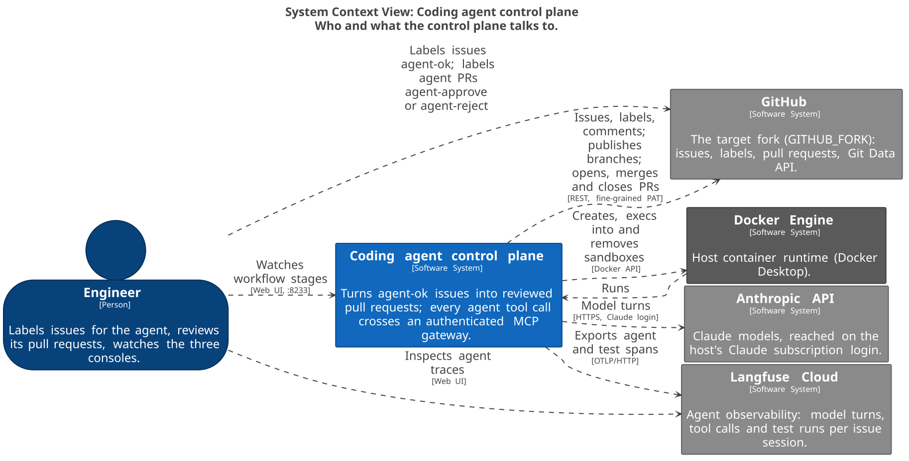
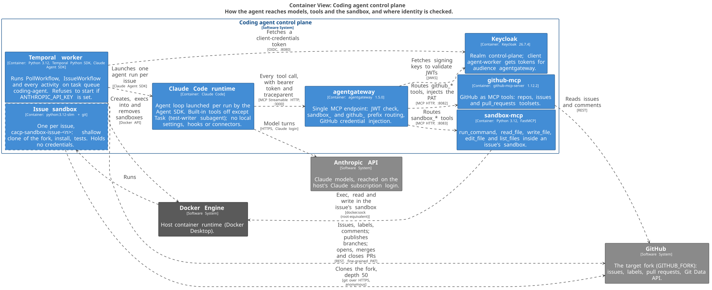

# Coding agent control plane

[](LICENSE)
[](pyproject.toml)
[](docs/architecture/README.md)
[](docs/adr/README.md)

A governed coding agent. A labelled GitHub issue becomes a reviewed pull request, and every
tool call the agent makes crosses an authenticated MCP gateway.



## Why

Tool-using agents are easy to build and hard to trust. Before a regulated firm lets one touch
its code, it needs answers to five questions: who is the agent when it calls a tool, what may
it call, where does its code run, what did it actually do, and who approved the result. This
project answers them in the architecture, not in the prompt.



## Controls

Phase W is a working baseline whose weaknesses are deliberate and documented
([ADR 0007](docs/adr/0007-a-deliberately-naive-baseline-first.md)). The next phase attacks
them; the phases after it close them.

| Control | Threat it addresses | Enforced in | Phase W status |
|---|---|---|---|
| One MCP gateway; the agent's built-in tools are off | The agent acting on the host or around the controls | `agent/run.py`, agentgateway | In place |
| A JWT on every tool call | Unauthenticated tool use | agentgateway, Keycloak | In place; one identity shared by every run |
| No credentials in the agent or the sandbox | Token theft through prompt injection | Gateway credential injection; publishing through the Git Data API | In place; GitHub write tools are still exposed to the agent ([ADR 0003](docs/adr/0003-the-agent-holds-no-credentials.md)) |
| One sandbox container per issue | Untrusted repository code running on the host | `sandbox/containers.py` | In place; `sandbox-mcp` holds the Docker socket, and paths are not confined |
| A human approval gate | Unreviewed agent changes merging | `IssueWorkflow` review signal | In place; who applied the label is not checked |
| Durable workflow history | Lost or silently repeated work; no audit trail | Temporal | In place; a retry can post a duplicate comment |
| End-to-end tracing | Agent behaviour nobody can inspect | Jaeger and Langfuse, `traceparent` through the gateway | In place |
| Localhost-only ports | Network exposure | `compose.yaml` | In place |

## How it works

1. A Temporal Schedule polls the fork every 60 seconds for open `agent-ok` issues.
2. One durable workflow per issue claims it and creates an isolated sandbox container.
3. The agent runs with a single tool source, the gateway, using a token from Keycloak.
4. It reads the issue through `github_*` tools and changes and tests the code through
   `sandbox_*` tools. A test-writer subagent adds the tests.
5. The control plane runs the full test suite, collects the changes and publishes them as
   branch `agent/issue-<n>` with a pull request. The agent never holds a credential.
6. A human labels the pull request `agent-approve` or `agent-reject`.
7. The workflow merges or closes it and reports the outcome on the issue.

Every step, in order: [issue to pull request](docs/architecture/README.md#one-issue-end-to-end).

## Quickstart

Prerequisites: Docker, [uv](https://docs.astral.sh/uv/), Claude Code signed in to a Claude
subscription, a fork of the target repository with a fine-grained personal access token
scoped to it, and a Langfuse project.

```bash
cp .env.example .env    # then fill in every empty value
docker compose up -d --build
uv sync
uv run python -B scripts/check_connections.py --send-test-traces
uv run python -m coding_agent_control_plane.worker
```

Then label an issue on the fork `agent-ok`. The worker refuses to start if
`ANTHROPIC_API_KEY` is set, so agent runs never switch silently to API billing
([ADR 0006](docs/adr/0006-run-the-agent-on-the-host-claude-login.md)).

| Console | Address | Shows |
|---|---|---|
| Temporal | http://localhost:8233 | Each issue's workflow and its current stage |
| Jaeger | http://localhost:16686 | Service traces: workflows, activities, gateway, sandbox |
| Langfuse | your Langfuse project | Agent traces: model turns, tool calls, test runs |

## Roadmap

- **Attack the baseline:** reproduce each Phase W weakness as a working attack.
- **Identity per run** instead of one shared client identity.
- **Policy per tool** at the gateway, starting with read-only `github_*` tools.
- **A sandbox without the Docker socket**, with paths confined to the workspace.
- **Idempotent activities**, so a retry never repeats a side effect.

## Documentation

- [Architecture](docs/architecture/README.md): a C4 model kept as code; every diagram is
  generated from it and checked for drift in CI.
- [Architecture decision records](docs/adr/README.md): why the system looks the way it does,
  including the costs accepted.

## How this was built

Designed, reviewed and verified by a human; implemented with Claude Code working under the
project conventions in [`CLAUDE.md`](CLAUDE.md). Every change passes the same gate:
`ruff check`, `ruff format --check`, `mypy --strict` and `pytest`, with the Agent SDK faked in
tests so the suite spends no model usage.

## Contact

Built at [Stacktician](https://stacktician.com): architecture, security and reliability for
tool-using AI agents. hello@stacktician.com

## License

Copyright 2026 Stacktician Limited. Licensed under the [Apache License, Version 2.0](LICENSE).
