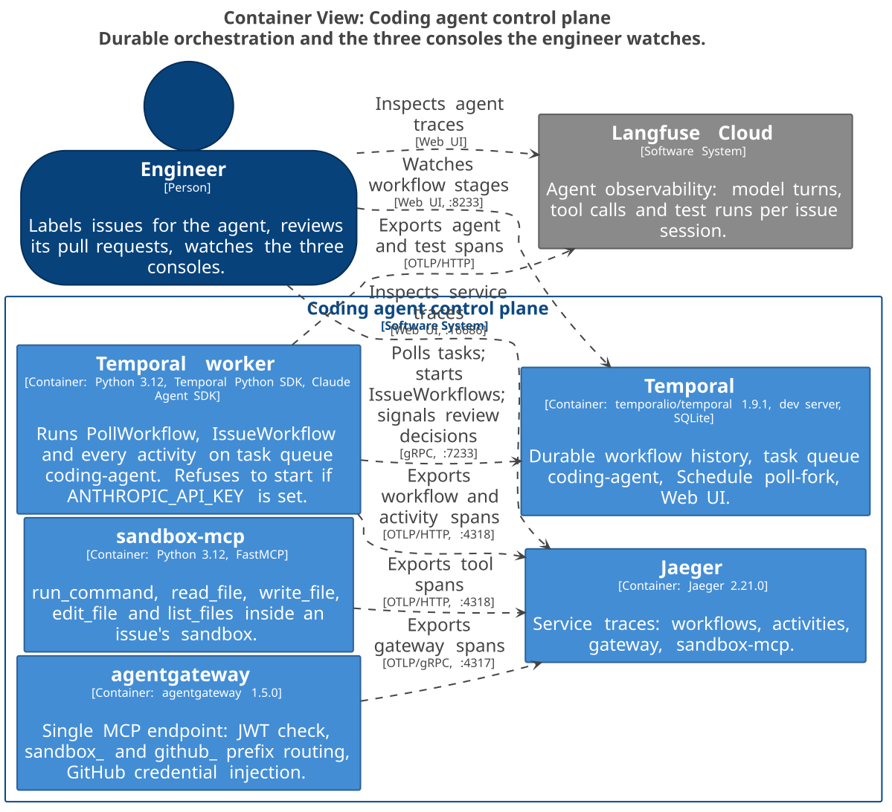
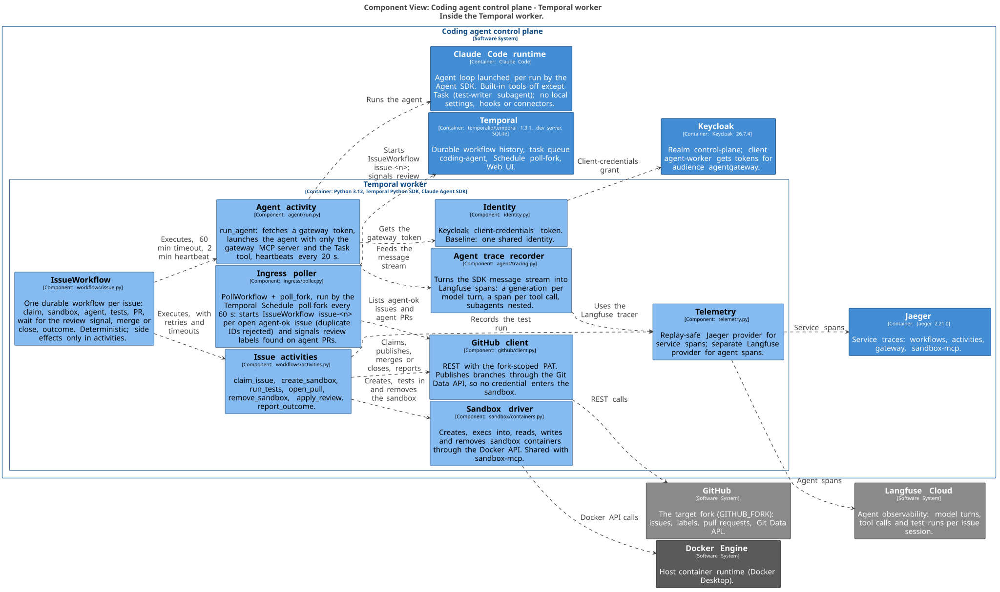
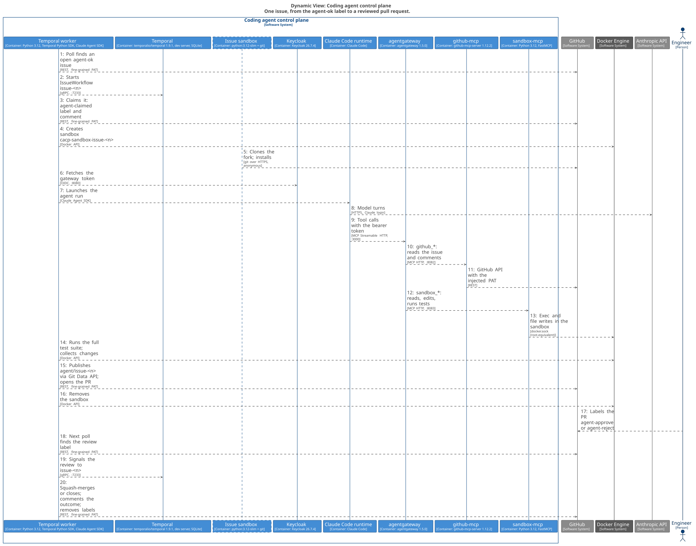
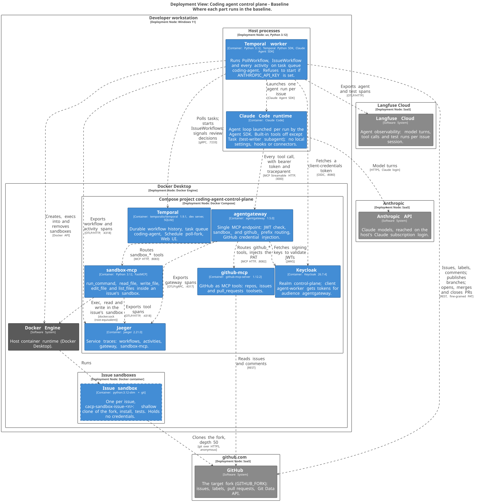

# Architecture

The architecture is a [C4 model](https://c4model.com) kept as code in
[`workspace.dsl`](workspace.dsl) ([Structurizr DSL](https://docs.structurizr.com/dsl)).
Every diagram below is generated from that one model, so they cannot disagree with each other.

## System context

Who and what the control plane talks to.


## Agent tool path

How the agent reaches models, tools and the sandbox, and where identity is checked.
Every tool call crosses agentgateway; the agent never holds the GitHub credential.


## Orchestration and observability

Durable orchestration in Temporal, and the three consoles: Temporal, Jaeger and Langfuse.



## Inside the worker



## One issue, end to end

From the `agent-ok` label to a reviewed pull request.



## Deployment



## Changing the diagrams

Edit only `workspace.dsl`. The SVGs are generated; never edit them by hand.

- **Render:** `scripts/render_architecture.sh` re-renders every view (needs Docker).
- **On commit:** the pre-commit hook in `.githooks/` re-renders and stages the SVGs whenever
  `workspace.dsl` is staged. Enable it once per clone: `git config core.hooksPath .githooks`.
- **In CI:** the `architecture` workflow re-renders and fails if the committed SVGs are stale.

To explore the model interactively, run the Structurizr viewer and open
http://localhost:8090 (port 8090, because Keycloak uses 8080):

```bash
MSYS_NO_PATHCONV=1 docker run -it --rm -p 127.0.0.1:8090:8080 -v "$(pwd)/docs/architecture:/usr/local/structurizr" structurizr/structurizr local
```

Save `workspace.dsl` and refresh the browser to see a change. The viewer writes
`workspace.json` and `.structurizr/` next to the model; both are gitignored.
